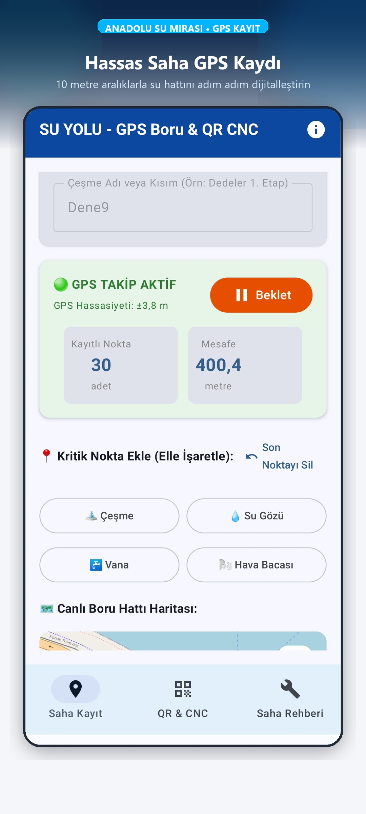
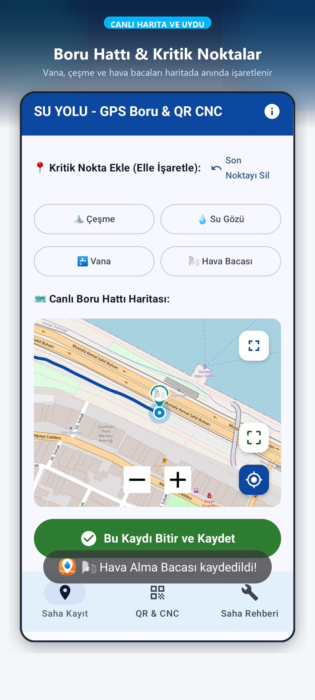
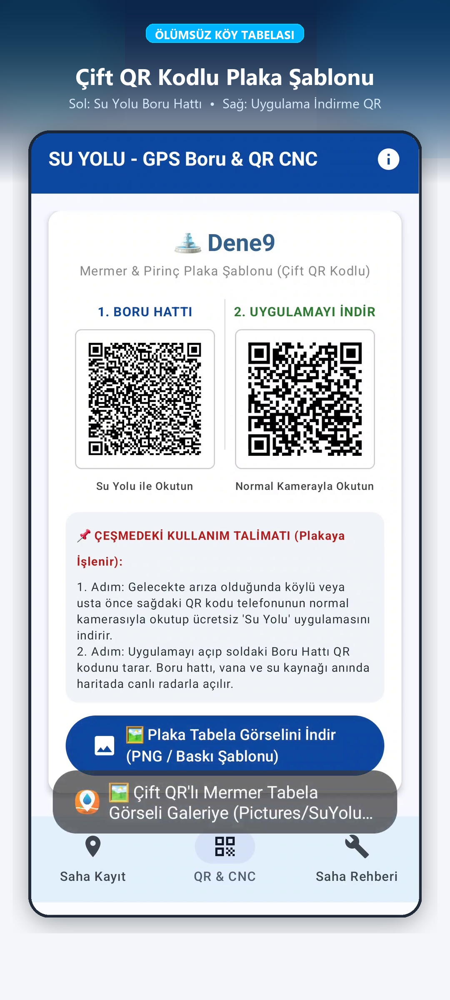
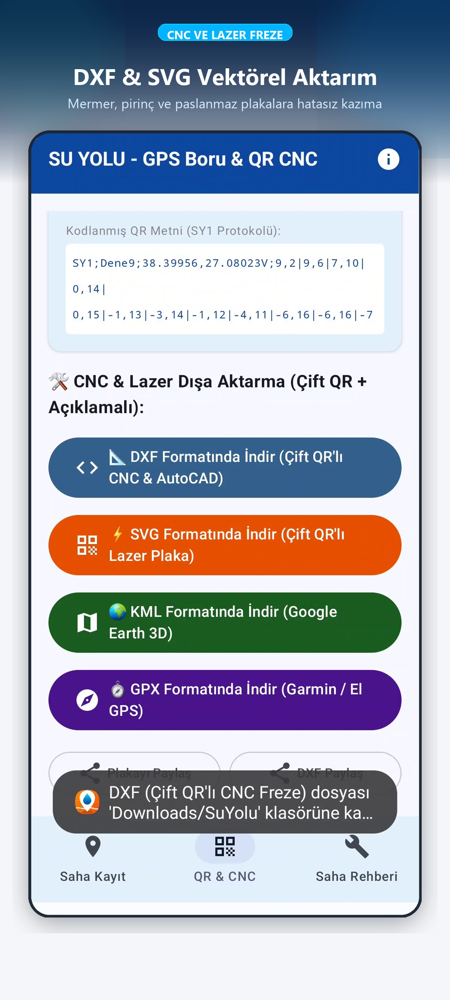
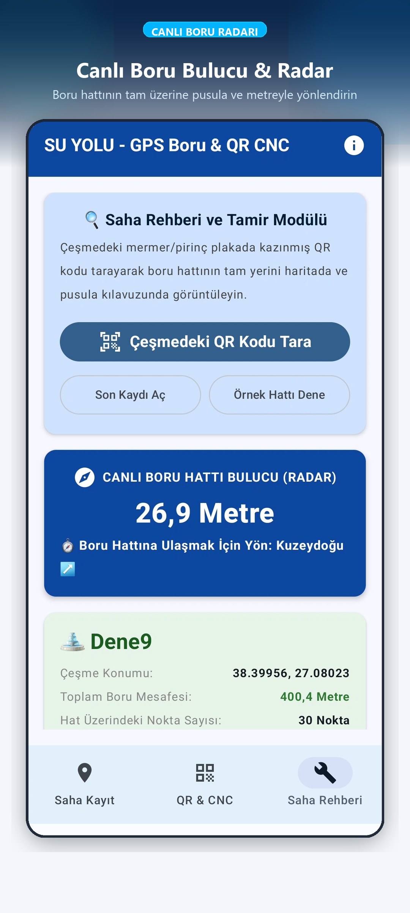
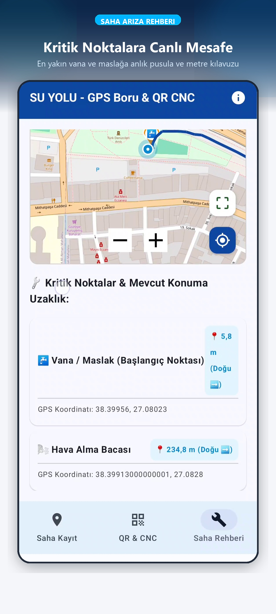
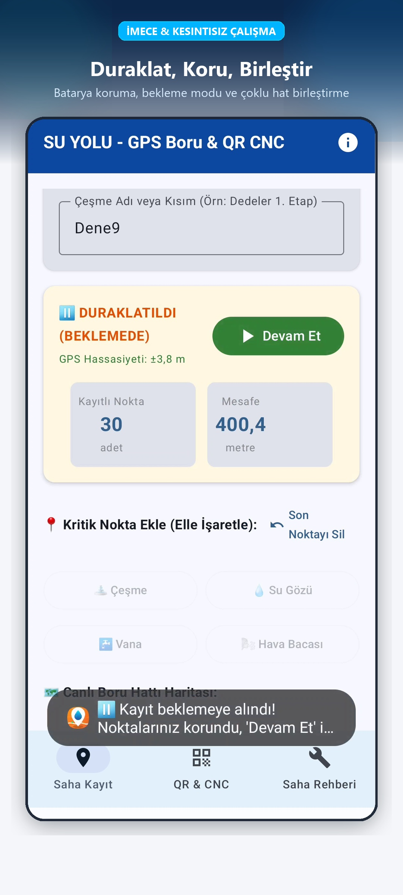

# 💧 Su Yolu - GPS Boru Hattı & Çift QR CNC Mermer Tabela Sistemi

<p align="center">
  
  
  
  
  
  
</p>

Anadolu'nun kadim çeşmelerini, su gözlerini, vanalarını ve kilometrelerce uzanan yeraltı su boru hatlarını **hassas GPS ile haritalandırma**, **çift QR kodlu CNC mermer tabela (kitabe) şablonları üretme** ve **canlı arıza radarıyla toprağın altındaki boruyu adım adım bulma** çözümü.

---

## 📌 Hızlı Bağlantılar
* 🌐 **Canlı Gizlilik Politikası:** [https://turgayyuzen.github.io/SuYolu/](https://turgayyuzen.github.io/SuYolu/)
* 📄 **Gizlilik Politikası (Markdown):** [PRIVACY_POLICY.md](./PRIVACY_POLICY.md)
* 🛡️ **Google Play Veri Güvenliği Rehberi:** [PLAY_CONSOLE_VERI_GUVENLIGI_REHBERI.md](./PLAY_CONSOLE_VERI_GUVENLIGI_REHBERI.md)
* 📜 **Açık Kaynak Lisansı:** [GPLv3 License](./LICENSE)

---

## 📸 Uygulama Ekran Görüntüleri

| 1. Saha GPS Kaydı | 2. Canlı Harita & Noktalar | 3. Çift QR Mermer Tabela |
| :---: | :---: | :---: |
|  |  |  |

| 4. CNC & Lazer Çıktısı (DXF/SVG) | 5. Canlı Boru Bulucu Radar | 6. Kritik Nokta Mesafe Rehberi | 7. İmece & Saha Duraklatma |
| :---: | :---: | :---: | :---: |
|  |  |  |  |

---

## 🌍 Projenin Amacı ve Çözdüğü Sorun

Anadolu köylerinde ve yaylalarında onlarca yıl önce köylülerin imece usulüyle dağlardan kazarak döşediği su boru hatlarının hiçbir resmi haritası veya projesi bulunmamaktadır. Boruları döşeyen yaşlı ustalar vefat ettiğinde, hatların nereden geçtiği unutulmakta; bir arıza veya patlak olduğunda kepçeler tarlaları, yolları ve arazileri günlerce rastgele kazarak boru aramaktadır.

**Su Yolu**, bu sorunu kökten ve kalıcı olarak çözer:
1. **Saha Taraması:** Köylü veya muhtar hattın üstünde yürürken her 10 metrede bir GPS koordinatı ve irtifa otomatik kaydedilir.
2. **Kritik Noktalar:** Kaynak (su gözü), çeşme, vana ve hava bacaları fotoğrafları ve açıklamalarıyla haritaya işlenir.
3. **Mermere Kazınan Hafıza (Ölümsüz Kitabe):** Hat verisi **SY1 sıkıştırma algoritmasıyla** tek bir QR koda dönüştürülür. Çeşmenin başına çakılacak mermer levha için çift QR kodlu CNC (`.DXF`) ve lazer (`.SVG`) şablonu oluşturulur.
4. **Gelecek Nesillere Miras:** 50 yıl sonra bile köye gelen biri çeşmedeki tabelayı okuttuğunda, harita anında telefonuna yüklenir ve **Canlı Boru Radarı** ile toprağın altındaki boruyu pusula ve metre rehberliğiyle santim santim bulur.

---

## ⚡ Temel Yetenekler & İnovasyonlar

### 1. Hassas GPS Kaydı & İmece Modu
* **10 Metre Hassasiyet:** Arka planda çalışan optimize Foreground Service ile hat boyunca her 10 metrede bir otomatik koordinat kaydı.
* **İmece / Duraklat-Devam Et:** Dağda yürürken yorulunca veya ertesi gün devam etmek istendiğinde kayıt duraklatılabilir; yeni segment bir önceki noktaya otomatik kaynaklanır.
* **Esnek Başlangıç Noktası:** Hat ister çeşmeden kaynağa, ister kaynaktan çeşmeye, isterse arazideki herhangi bir vana veya boru noktasından başlatılabilir.

### 2. SY1 Delta Sıkıştırma Algoritması
* Standart GPS JSON dosyaları binlerce nokta içerdiğinde yüzlerce kilobayt tutar ve QR koda sığmaz.
* **Su Yolu SY1 Formatı:** İlk koordinatı referans alarak sonraki tüm noktaları mikro derece farkları (delta-encoding) ve base64/hex optimizasyonuyla sıkıştırır.
* Kilometrelerce uzanan boru hattı verisini **tek bir standart QR kod içerisine (< 2 KB)** sığdırır.

### 3. Çift QR Kodlu CNC Mermer Tabela & Vektörel Çıktı
* **Sol QR (Uygulama İndir):** Sahada interneti olan kullanıcının uygulamayı Play Store'dan yüklemesini sağlayan evrensel link.
* **Sağ QR (Hat Verisi):** İnternet olmasa dahi Su Yolu uygulamasıyla taratıldığında tüm hattı anında çevrimdışı haritaya yükleyen veri paketi.
* **Mermer & Lazer Entegrasyonu:** Mermer ustaları ve CNC/Lazer atölyeleri için endüstri standardı **AutoCAD DXF** ve **Vektörel SVG** dosya çıktısı.

### 4. Canlı Boru Bulucu Radar
* **Sensör Füzyonu:** Telefonun dahili Manyetometre (Pusula) ve GPS donanımını birleştirir.
* **Adım Adım Kılavuzluk:** Kullanıcı arazide yürürken boru hattına olan dik mesafeyi (kaç metre sağında/solunda kaldığını) ve en yakın vana/su gözünün yönünü canlı hedef radarıyla gösterir.
* **Kazı Öncesi Güvenlik:** Kepçe operatörüne veya tamir ekibine borunun tam üzerinden geçtiği hattı santimetre/metre hassasiyetinde işaretler.

### 5. %100 Çevrimdışı ve Bağımsız Çalışma
* Dağlarda, kanyonlarda ve şebekenin çekmediği derin vadilerde tam kapasite çalışır.
* **osmdroid:** Önceden önbelleğe alınan OpenStreetMap harita karolarıyla internetsiz harita navigasyonu.
* Sıfır sunucu, sıfır bulut bağımlılığı; tüm veriler tamamen yerel cihazda ve mermer tabelanın üzerindeki QR kodda saklanır.

---

## 🛠️ Teknoloji Mimarisi

* **Platform:** Android 8.0+ (API 26+)
* **Dil:** Kotlin (Modern Coroutines & Flow)
* **Kullanıcı Arayüzü:** Jetpack Compose + Material 3 Design System
* **Harita & CBS:** osmdroid (OpenStreetMap Android SDK)
* **Konum Servisleri:** Android LocationManager & Fused Location Provider (Foreground Service)
* **Donanım Entegrasyonu:** Android SensorManager (Compass / Azimuth Fusion)
* **Vektör & Kodlama:** ZXing QR Engine + Custom DXF / SVG Generation Engine
* **Yerel Depolama:** Android Jetpack Room / SharedPreferences / Scoped Storage
* **Mimari:** Modern Android Architecture (MVVM, Clean Architecture, StateFlow, Single Source of Truth)

---

## 📂 Proje Dizin Yapısı

```
SuYolu/
├── app/
│   ├── src/
│   │   ├── main/
│   │   │   ├── java/com/turga/suyolu/
│   │   │   │   ├── algorithm/     # SY1 Delta sıkıştırma & parsing algoritmaları
│   │   │   │   ├── data/          # Room entity, DAO, Repository & model yapıları
│   │   │   │   ├── export/        # CNC DXF & Lazer SVG vektör üretim motoru
│   │   │   │   ├── qr/            # ZXing QR kod oluşturma & matris işleme
│   │   │   │   ├── service/       # Saha GPS takip Foreground Service
│   │   │   │   └── ui/
│   │   │   │       ├── components/ # Harita, radar & gösterge bileşenleri
│   │   │   │       ├── screens/    # Ana Sayfa, Kayıt, Radar & Tabela ekranları
│   │   │   │       └── theme/      # Material 3 renk ve tipografi teması
│   │   │   ├── res/               # İkonlar, mipmap, XML ve layout kaynakları
│   │   │   └── AndroidManifest.xml
│   │   └── test/                  # Birim ve entegrasyon testleri
│   └── build.gradle.kts
├── docs/                          # GitHub Pages web dokümantasyonu (index.html)
├── gradle/                        # Gradle wrapper ve libs.versions.toml
├── marketing_assets/              # Play Store ekran görüntüleri & tanıtım materyalleri
├── index.html                     # Web sitesi & Gizlilik politikası ana sayfası
├── privacy_policy.html            # Resmi gizlilik politikası (TR / EN)
├── PRIVACY_POLICY.md              # Markdown formatında gizlilik politikası
├── PLAY_CONSOLE_VERI_GUVENLIGI_REHBERI.md # Play Console Data Safety formu rehberi
├── LICENSE                        # GNU General Public License v3.0
└── README.md
```

---

## 🚀 Kurulum ve Derleme (Build & Run)

### Ön Koşullar
* **Android Studio:** Ladybug (2024.2.1+) veya Meerkat
* **JDK:** Java 17+
* **Android SDK:** Compile SDK 35, Min SDK 26

### Adımlar
1. Projeyi klonlayın:
   ```bash
   git clone https://github.com/turgayYuzen/SuYolu.git
   cd SuYolu
   ```
2. Bağımlılıkları senkronize edin ve Debug APK derleyin:
   ```bash
   ./gradlew assembleDebug
   ```
3. Cihaza yükleyin:
   ```bash
   adb install -r app/build/outputs/apk/debug/app-debug.apk
   ```

---

## 📄 Lisans (License)

Bu proje **GNU General Public License v3.0 (GPL-3.0)** altında lisanslanmıştır.  
Kırsal mirasımızı, imece kültürümüzü ve su kaynaklarımızı korumak amacıyla kamu yararına açık kaynak olarak geliştirilmiştir.

Detaylar için [LICENSE](./LICENSE) dosyasını inceleyebilirsiniz.

---

## 👤 Geliştirici & İletişim

* **Geliştirici:** Turgay Yüzen
* **E-posta:** [turgayyuzen@gmail.com](mailto:turgayyuzen@gmail.com)
* **GitHub:** [@turgayYuzen](https://github.com/turgayYuzen)
* **Proje Deposu:** [https://github.com/turgayYuzen/SuYolu](https://github.com/turgayYuzen/SuYolu)
